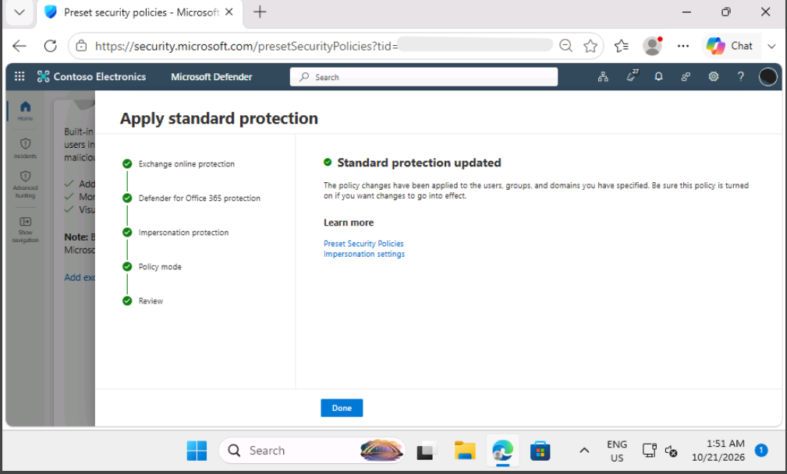
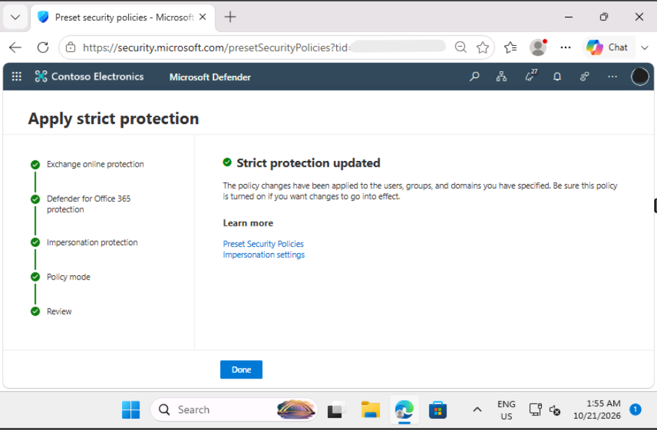
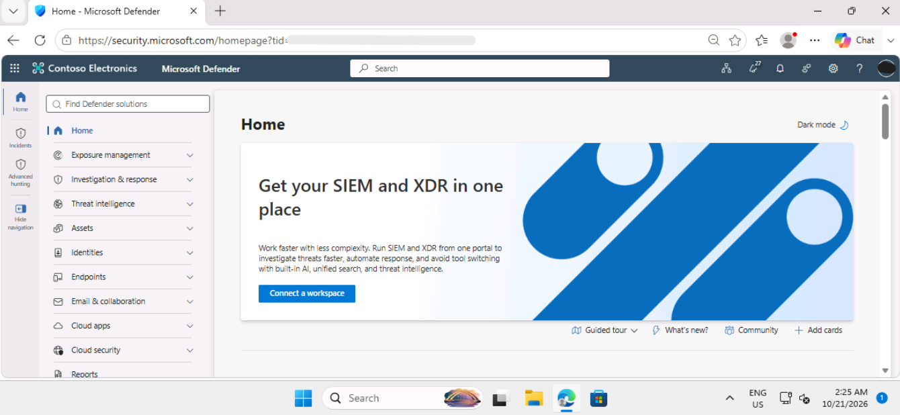

# Lab 1: Explore Microsoft Defender XDR

## Summary

I completed this lab as part of my SC-200 preparation, working as a security analyst in a training tenant for a fictional company called Contoso Electronics. I turned on Microsoft's preset email protection and set up the Microsoft Defender XDR workspace.

## Tools used

- Microsoft Defender XDR portal
- Microsoft Defender for Office 365
- Exchange Online Protection

## What I did

### 1. Applied Standard protection

In the Defender portal, I went to Email & collaboration, then Policies & rules, then Threat policies, then Preset security policies. I applied Standard protection to my tenant's domain. This switches on anti-spam, anti-malware, and anti-phishing protection, plus Safe Attachments and Safe Links.

### 2. Applied Strict protection

I applied Strict protection to a smaller group of users (the Leadership group). Strict protection uses tighter settings, so it suits people who are more likely to be targeted.

### 3. Set up the Defender XDR workspace

I opened the Devices page, which started the workspace setup. After about five minutes, the Home page showed the "Get your SIEM and XDR in one place" banner, which confirmed the setup had finished.

## Problems I ran into

(Add anything that went wrong and how you fixed it, for example an error message that you closed and a page that you refreshed. If nothing went wrong, delete this section.)

## What the results mean

- **Standard protection** gives every user a solid baseline of email protection.
- **Strict protection** applies tighter settings to higher-risk users.
- **The workspace setup** prepares Defender XDR so that later labs can use incidents, alerts, and advanced hunting.

## Security note

Preset policies save time, but they should still be reviewed. A security team needs to check who each policy applies to, and not assume every user is covered.

## What I learned

I learned how preset security policies in Microsoft Defender for Office 365 allow security administrators to quickly deploy baseline protection using standard or strict templates. Applying Strict protection to high-risk groups like executive leadership helps defend targets that are more likely to face sophisticated phishing and spear-phishing attacks. Setting up the unified Defender XDR workspace highlighted how Microsoft combines endpoint, identity, and email security under one platform.
