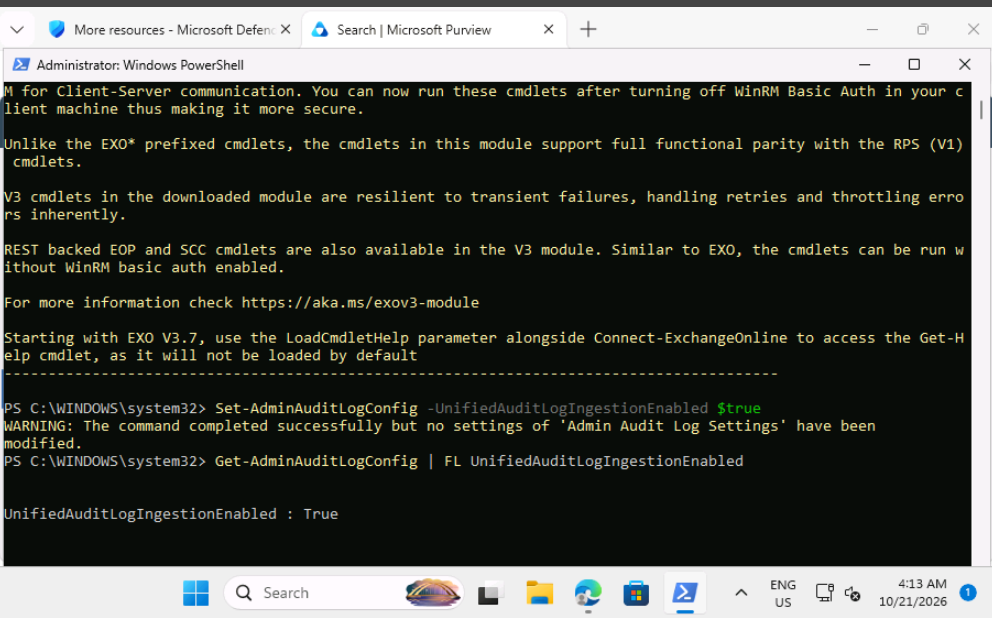

# Lab 2: Explore Microsoft Purview Audit Logs

## Summary

I completed this lab as part of my SC-200 preparation, working as a security analyst in a training tenant for a fictional organization. The goal was to make sure audit logging was turned on in Microsoft Purview, so that user and admin activity is recorded for investigations and compliance.

## Tools used

- Microsoft Purview portal (Audit)
- Microsoft Defender XDR portal
- Windows PowerShell with the Exchange Online Management module

## Why audit logging matters

Audit logs record who did what in an environment. Without them, a security team cannot investigate an incident properly, and an organization cannot show that access to sensitive data, such as patient records, is being tracked.

## What I did

### 1. Opened Purview and went to Audit

From the Defender XDR portal I opened the Microsoft Purview portal, then went to Solutions and chose Audit. I looked for the option to start recording user and admin activity.

### 2. Checked the audit setting with PowerShell

The Audit page showed an error about recording status, so I used the workaround from the lab. I installed the Exchange Online Management module, connected to Exchange Online, and ran the command to turn on audit ingestion. PowerShell reported that no settings were modified, which suggests audit logging was already on.

### 3. Verified that audit logging is enabled

I ran `Get-AdminAuditLogConfig | FL UnifiedAuditLogIngestionEnabled`. The result was True, which confirms audit logging is enabled.

I then ended the session with `Disconnect-ExchangeOnline`.

## Problems I ran into

 The Purview page showed an error about recording status, so I used the PowerShell workaround. 

## What the results mean

- **UnifiedAuditLogIngestionEnabled: True** means activity is being recorded in the unified audit log.
- **"No settings modified"** means the setting already had the value I tried to set.
- The lab notes that it can take up to 60 minutes before activity starts appearing in searches.

## Security note

Audit logging should be on from the start. It can't record activity from before it was switched on, so turning it on late leaves a gap that an investigator cannot fill.

## What I learned

I learned that verified audit logging is foundational to security investigations because turning it on after an incident occurs leaves permanent forensic gaps. Using PowerShell to verify UnifiedAuditLogIngestionEnabled proved how crucial command-line tools are when the web portal encounters UI errors. Understanding that audit log data can take up to 60 minutes to appear is also key for timing during active threat hunting.
