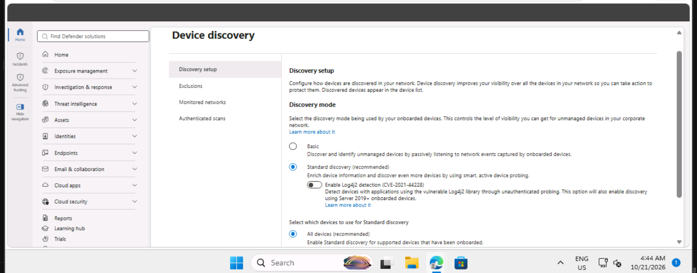
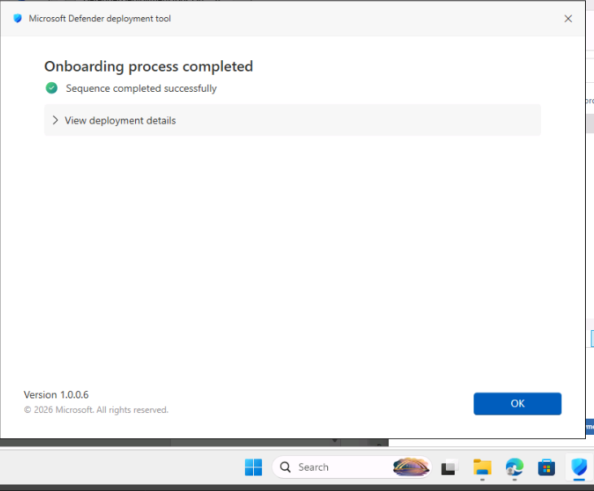
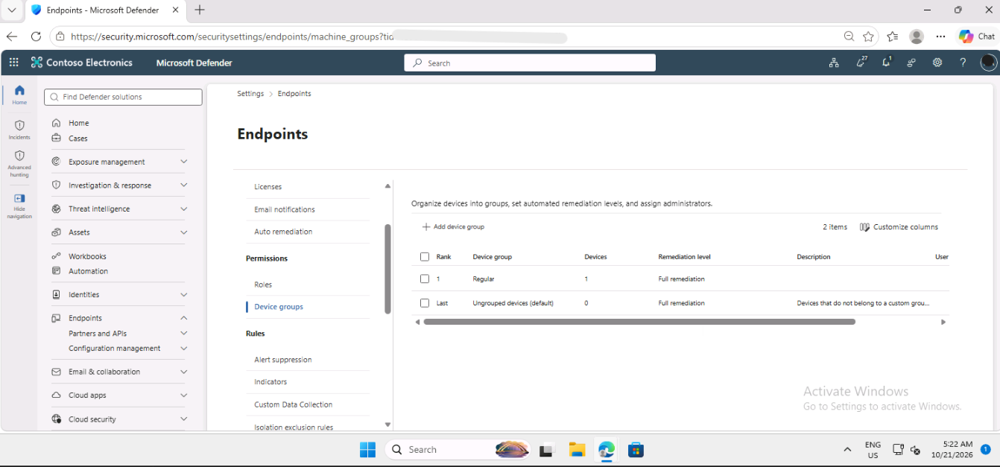

# Lab 3: Deploy Microsoft Defender for Endpoint

## Summary

I completed this lab as part of my SC-200 preparation, working as a security analyst in a training tenant for a fictional company. I set up Microsoft Defender for Endpoint: I turned on device discovery, onboarded a device, created a custom role, and organised devices into a device group.

## Tools used

- Microsoft Defender XDR portal
- Microsoft Defender for Endpoint
- Defender deployment tool

## What I did

### 1. Turned on device discovery

In the Defender portal I went to Settings, then Device discovery, and checked that Standard discovery was selected. Discovery finds devices on the network, including ones that are not yet protected.

### 2. Onboarded a device

I generated a deployment tool in the portal and ran it on the lab machine, WIN1. Onboarding connects the device to Defender for Endpoint, so it can send security data and be protected. Afterwards, the device appeared in the device inventory.

### 3. Created a custom role

I created a role called Tier 1 Support with read and manage permissions for security operations, and assigned it to a user group. Roles make sure that each person only gets the access their job needs.

### 4. Created a device group

I created a device group called Regular with full remediation and gave the same user group access to it. The device list then showed two groups: Regular and Ungrouped devices (default).

## What the results mean

- **Standard discovery** finds devices by passively watching network traffic.
- **An onboarded device** shows up in the inventory and sends data to Defender.
- **A custom role** limits what a team member can see and change.
- **Full remediation** lets Defender fix threats on those devices automatically.

## Security note

The deployment key that onboards devices is a secret. Anyone who has it could connect a device to the tenant, so it should never be shared or published. I left it out of my screenshots on purpose.

## What I learned

I learned that onboarding devices to Microsoft Defender for Endpoint goes beyond basic antivirus installation by integrating endpoints directly into a unified security monitoring platform. Configuring custom roles and device groups demonstrated the practical application of the Principle of Least Privilege, ensuring Tier 1 analysts have appropriate permissions while automated remediation policies isolate and fix threats quickly.
