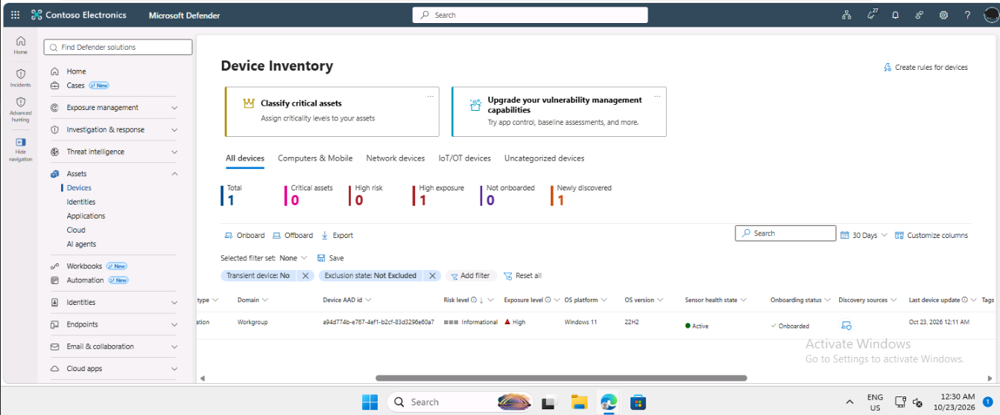
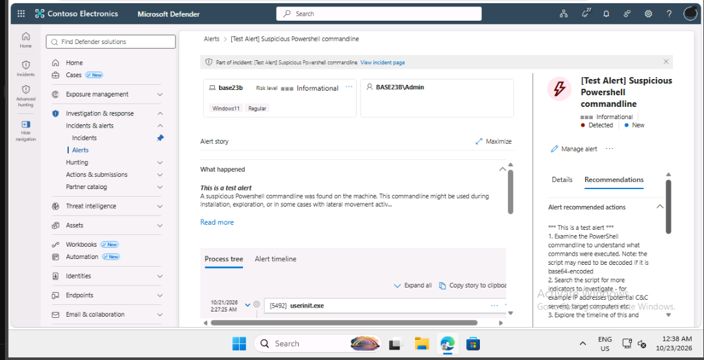
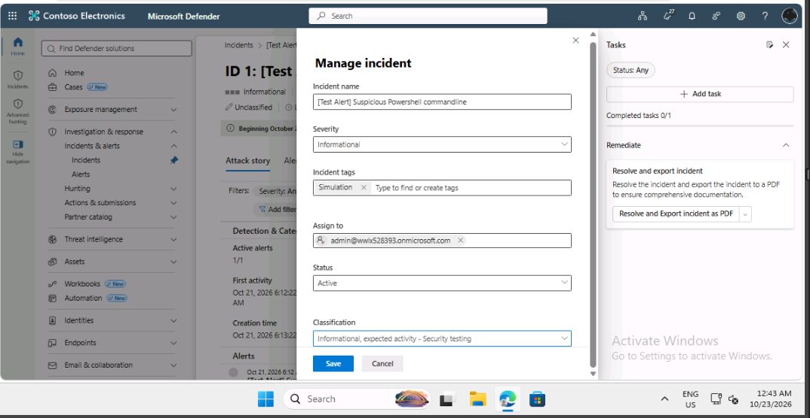
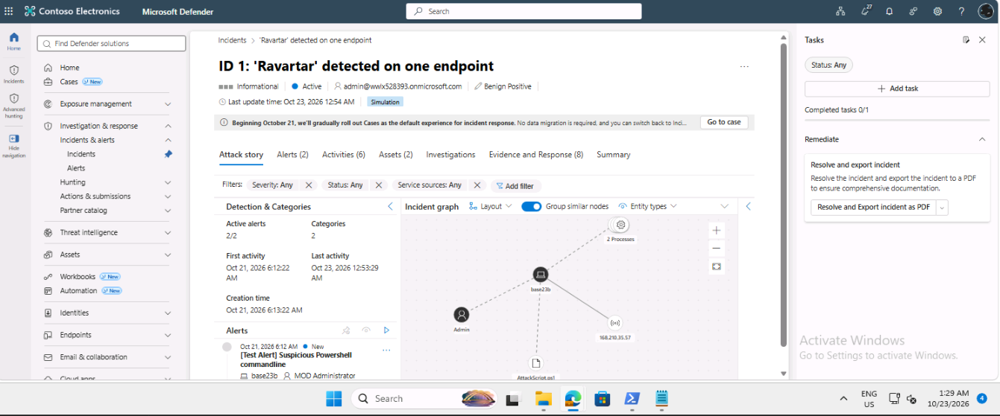

# Lab 4: Mitigate Attacks with Microsoft Defender for Endpoint

## Summary

I completed this lab as part of my SC-200 preparation, working as a security analyst in a training tenant for a fictional company. I checked that a device was onboarded to Defender for Endpoint, investigated a test alert, classified the incident, and then investigated a simulated attack.

## Tools used

- Microsoft Defender XDR portal
- Microsoft Defender for Endpoint
- Windows Security on the lab machine
- Windows PowerShell on the lab machine

## Steps I took

### 1. Verified that the device was onboarded

In the device inventory, the lab machine appeared under its computer name. Its onboarding status was Onboarded and its sensor health was Active, which means it was reporting to Defender for Endpoint.

### 2. Investigated a test alert

I ran Microsoft's detection test on the lab machine, and a test alert about a suspicious PowerShell command line appeared in the portal. I reviewed the alert story, the device and user involved, and the recommended actions.

### 3. Classified the incident

I opened the incident, added a Simulation tag, assigned it to my admin account, and classified it as informational, expected activity (Security testing). Tags, owners and classifications help a team keep track of incidents and avoid wasting time on tests.

### 4. Investigated a simulated attack

I ran the lab's simulated attack script on the lab machine. In the portal I opened the incident and looked at the attack story. The incident graph connected the device, the user account, the script file and an external IP address, which is the address the simulated attack tried to contact.

## Problems I ran into

 Defender flagged the lab's script as malware and I quarantined it, so I restored it in Windows Security before running it.

## What the results mean

- **Onboarded and Active** means the device is sending security data to Defender.
- **A test alert** proves the whole pipeline works, from the device to the portal.
- **The incident graph** shows how alerts and entities connect, so an analyst can see the whole attack in one place.
- **Defender blocking the script** shows that endpoint protection was working.

## Security note

The attack script was safe only because it ran inside a training lab machine. Simulated attacks should never be run on a personal or work computer. I also kept the script's code, the admin email and tenant details out of this repository on purpose.

## What I learned

I learned how Microsoft Defender XDR correlates multiple related alerts into a single incident graph, allowing analysts to trace the full attack chain across files, users, endpoints, and external IP addresses. Experiencing how Defender automatically quarantined the test script proved the power of proactive endpoint protection, while classifying the incident as expected security testing highlighted the importance of proper incident management in preventing queue clutter.
