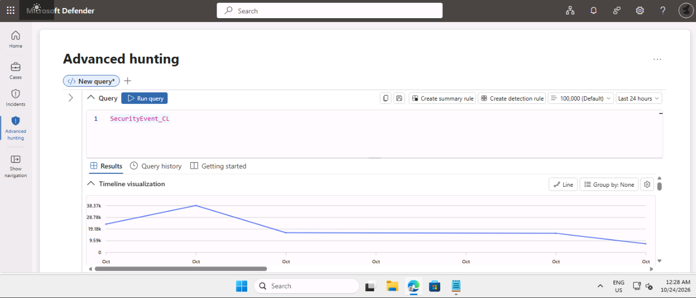
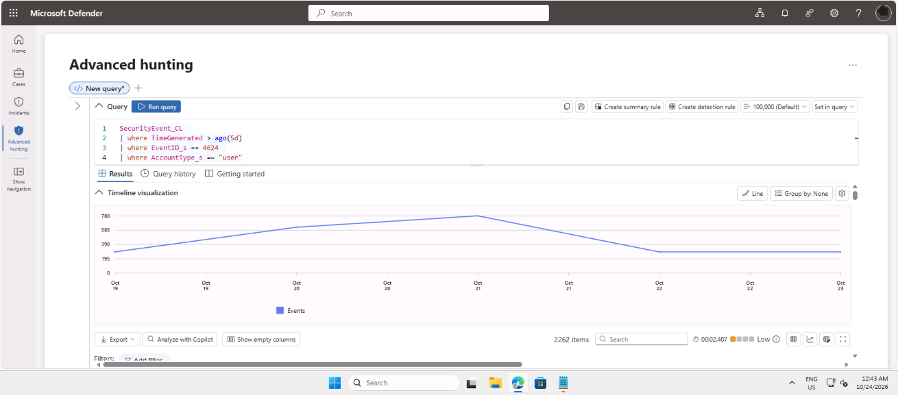
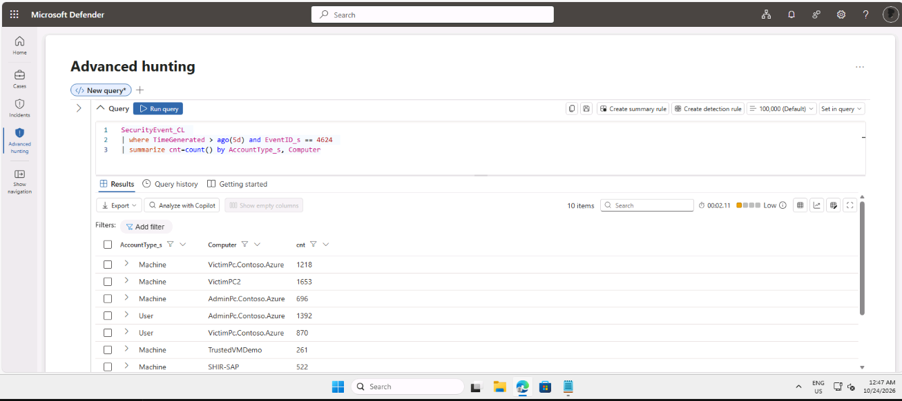
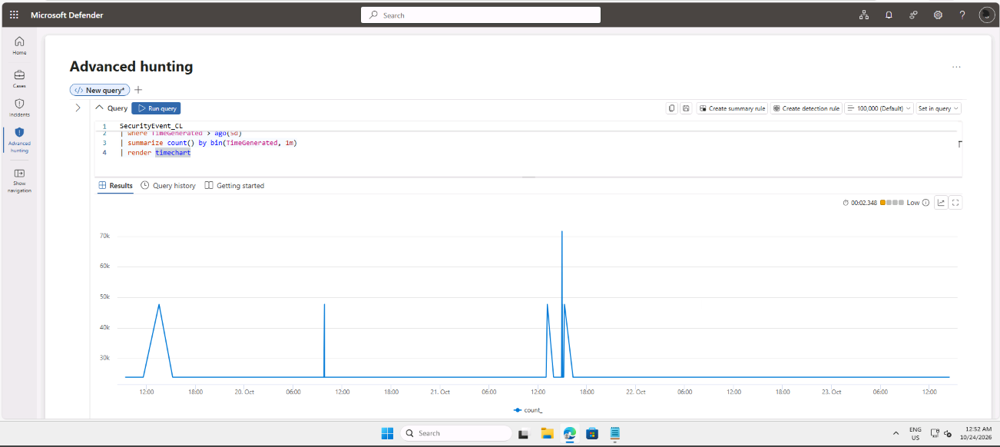
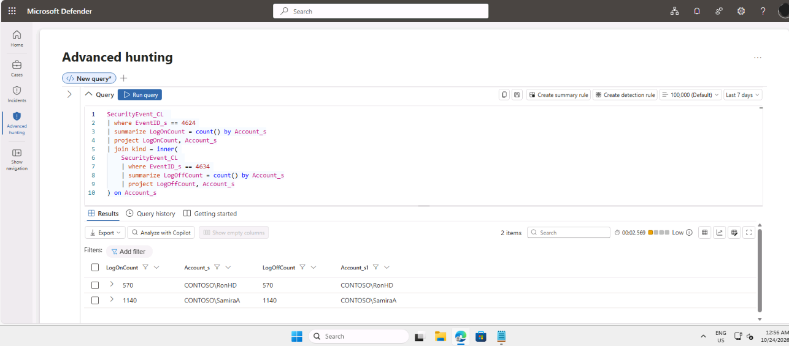

# Lab 5: Create Queries for Microsoft Sentinel Using KQL

## Summary

I completed this lab as part of my SC-200 preparation, working as a security analyst in a training tenant for a fictional company. I used Kusto Query Language (KQL) in Advanced hunting to search sample log data, filter it, summarise it, draw charts, and combine tables.

## Tools used

- Microsoft Defender XDR, Advanced hunting
- Kusto Query Language (KQL)
- Practice tables with sample security events and sign-in logs

## What I did

### 1. Looked at the raw data

I started by running a query that returns every row of the sample security events table. This showed me what the columns look like before I filtered anything.

### 2. Filtered with where

I used `where` to keep only the rows I cared about: successful sign-ins (event ID 4624) for user accounts. Filtering early makes a query faster and the results easier to read.

### 3. Summarised the results

I used `summarize` with `count()` to turn many rows into a short table, for example the number of sign-ins per computer and account type. This is how an analyst spots which machines or accounts stand out.

### 4. Drew a chart

I added `render columnchart` to show counts as a chart. A picture makes unusual spikes obvious much faster than a table does.

### 5. Combined two sets of results

I used `join` to line up sign-in counts and sign-off counts for each account. Combining data like this helps answer questions that one query alone cannot.

## My own queries

SecurityEvent
| where TimeGenerated > ago(7d)
| where EventID == 4625
| summarize FailedAttempts = count() by Account
| top 5 by FailedAttempts desc

What this showed: This query isolates failed logon events (Event ID 4625) over the past 7 days, groups them by user account, and returns the top 5 accounts with the highest number of failed login attempts—a classic technique for spotting potential brute-force password attacks.

## Problems I ran into

A query that gave an error because of pasted text, I had to open a Notebook and paste the text there before I copied and pasted it in KQL.

## What the results mean

- **where** narrows the data, **summarize** counts it, **render** draws it, and **join** combines it.
- The order of the steps matters. Filtering before summarising gives a different result from summarising before filtering.
- Failed sign-ins grouped by account are a common starting point for spotting password attacks.

## Security note

The data in this lab is fictional practice data. In a real tenant, query results can contain real user names, IP addresses and device names, so they should be covered before anything is shared publicly.

## What I learned

I learned how to navigate and interpret the incident graph to quickly identify how a simulated attack originated and spread across an endpoint. Practical handling of test alerts taught me how essential it is to tag, assign, and accurately classify security events so that genuine threats receive immediate priority.
