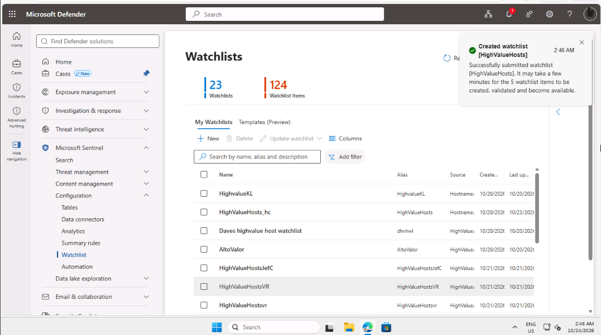
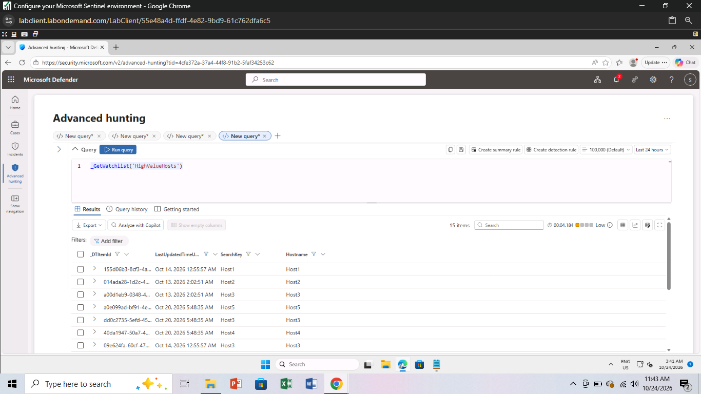
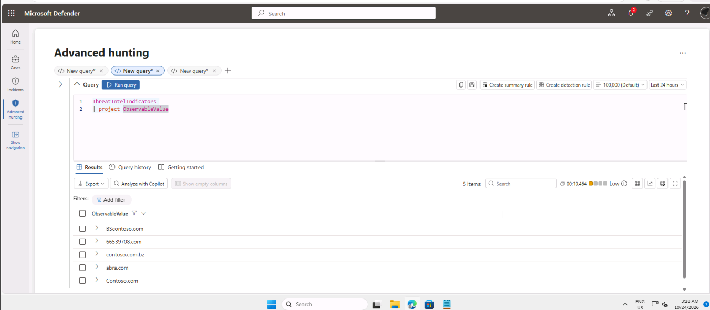
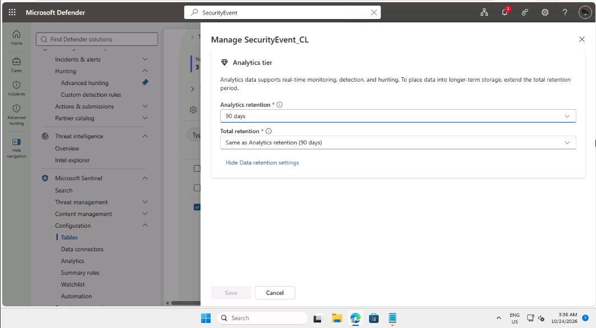

# Lab 6: Configure the Microsoft Sentinel Environment

## Summary

I completed this lab as part of my SC-200 preparation, working as a security analyst in a training tenant for a fictional company. I set up three parts of Microsoft Sentinel: a watchlist, a threat intelligence indicator, and a longer log retention period.

## Tools used

- Microsoft Defender portal (Microsoft Sentinel section)
- Advanced hunting and KQL
- Notepad, to create the watchlist file

## What I did

### 1. Created a watchlist

A watchlist is a saved list that queries can use. I made a small file with a Hostname column and five sample host names, then uploaded it as a watchlist called HighValueHosts, using Hostname as the search key. The portal confirmed that the watchlist was created.

Once the data had loaded, I ran a query that reads the watchlist, and it returned my five hosts.

### 2. Created a threat indicator

An indicator is a known-bad item, such as a malicious domain, that Sentinel can match against logs. I created an indicator for a made-up domain, then ran a query on the threat intelligence table to confirm that it arrived. The result showed my domain, **(write your domain here)**, in the ObservableValue column.

### 3. Changed log retention

I opened the settings for the SecurityEvent_CL table and set the analytics retention to 90 days. The total retention then matched it at 90 days. Keeping logs longer helps an investigation look further back in time, but it can increase cost.

## Problems I ran into

The portal menu was different from the lab text, so I created the indicator through Intel explorer. 

## What the results mean

- **A watchlist** lets a query compare events against a list I control, such as important servers.
- **An indicator** lets Sentinel recognise a known-bad domain when it appears in logs.
- **Retention** decides how far back an analyst can search.
- Data from a new watchlist or indicator can take several minutes to appear, so a check straight away may show nothing.

## Security note

I only used a made-up domain and fictional host names. A real indicator should come from a trusted source, because a wrong indicator can raise false alerts or hide a real threat.

## What I learned

I learned how Microsoft Sentinel uses watchlists to enrich threat hunting queries with internal context, such as flagging high-value servers. Managing threat indicators and log retention taught me how security analysts balance active threat detection with storage costs, ensuring logs are kept long enough for deep historical investigations.
